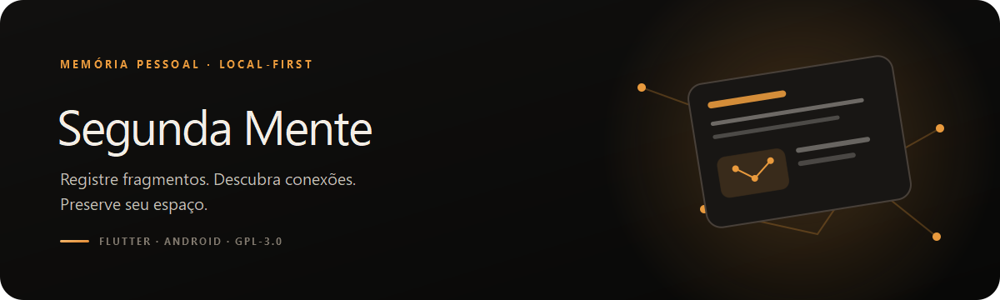
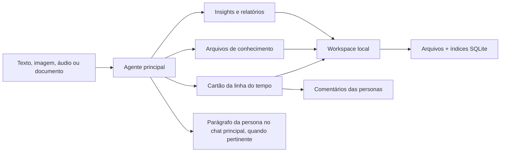

<p align="center">
  
</p>

<p align="center">
  <a href="https://github.com/playertwo1/segundamente-app/releases/tag/v1.0.46"><strong>Android v1.0.46</strong></a> · Release privada do GitHub; exige acesso ao repositório.
</p>

<p align="center">
  <strong>Um diário de vida local-first que organiza registros com IA, memória e personas.</strong>
</p>

<p align="center">
  <a href="LICENSE"></a>
  
</p>

A Segunda Mente ajuda a guardar pensamentos, conversas, imagens e documentos sem exigir que você escreva um diário organizado. Você registra em fragmentos; agentes de IA ajudam a transformá-los em cartões da linha do tempo, arquivos de conhecimento e relatórios que continuam no seu workspace.

> **Estado do projeto:** o roadmap registra o MVP como concluído. O desenvolvimento continua em fases posteriores. O foco e a validação atual são Android; este repositório não anuncia uma versão nas lojas.

## Conteúdo

- [O que o aplicativo faz](#o-que-o-aplicativo-faz)
- [Atualizações do aplicativo](#atualizações-do-aplicativo)
- [Como os dados circulam](#como-os-dados-circulam)
- [Privacidade e armazenamento](#privacidade-e-armazenamento)
- [Modelos de IA](#modelos-de-ia)
- [Instalar para desenvolvimento](#instalar-para-desenvolvimento)
- [Testes e análise](#testes-e-análise)
- [Estrutura do código](#estrutura-do-código)
- [Documentação do projeto](#documentação-do-projeto)
- [Origem e licença](#origem-e-licença)

## O que o aplicativo faz

- Registra texto, imagens, áudio, transcrições e documentos nos fluxos suportados.
- Organiza registros em cartões da linha do tempo e arquivos Markdown de conhecimento.
- Gera insights que ajudam a encontrar padrões e relações entre registros.
- Permite criar personas que comentam nos registros, conversar com elas e incluir uma contribuição contextual no chat principal quando o assunto combina.
- Orienta as personas a responder com 3 a 6 frases em conversas substantivas, evitando repetição e conteúdo de preenchimento; Quick Query não inclui essa participação.
- Cria relatórios de sessões com resumos, decisões, ideias, tarefas e referências a trechos ou horários.
- Exporta relatórios em Markdown, PDF e DOCX.
- Mantém busca, dados estruturados e arquivos do workspace no dispositivo ou no local de armazenamento escolhido.

A leitura de anexos e as capacidades de cada fluxo dependem do modelo configurado. Conversas aprofundadas a partir de comentários e criação de documentos nesses fios fazem parte da F10; consulte [o roadmap](ROADMAP.md) para acompanhar o estado e as evidências.

## Atualizações do aplicativo

No Android Stable e Early, **Configurações** permite consultar e baixar releases públicas diretamente de `playertwo1/segundamente-app` no GitHub, sem necessidade de token ou senha. O canal Dev não oferece essa função.

## Como os dados circulam



Os arquivos originais e os dados do workspace são separados dos índices SQLite. Agentes especializados executam tarefas como criar cartões, organizar conhecimento e gerar relatórios. Tarefas demoradas podem continuar em segundo plano e são coordenadas pelo sistema local de tarefas.

## Privacidade e armazenamento

A Segunda Mente é local-first: o workspace do usuário fica no armazenamento escolhido no aparelho, com SQLite para índices e dados de consulta. O projeto não depende de um servidor próprio para guardar o diário.

Recursos de IA usam o provedor configurado. Quando você envia uma mensagem, anexo ou pede uma análise com um modelo remoto, o conteúdo necessário para aquela solicitação é transmitido ao provedor. Revise as condições do provedor e escolha o que deseja enviar. Um modelo local, como Ollama, depende de um servidor local acessível e da configuração correspondente.

Credenciais são mantidas no armazenamento seguro do dispositivo e não devem ser incluídas no repositório. O contexto de localização é opcional e vem desligado por padrão; só é usado quando você o ativa nas configurações.

## Modelos de IA

A configuração atual permite conectar:

- OpenAI, pela API Chat Completions, Responses ou login OAuth disponível no app;
- Google Gemini, pela API ou OAuth;
- Anthropic Claude por API; modelos Claude também podem estar disponíveis via Google OAuth/Vertex, conforme a configuração; o app não usa login Claude.ai por assinatura;
- Claude no AWS Bedrock;
- OpenRouter;
- Ollama, em endpoint local ou de rede configurado pelo usuário.

A disponibilidade de visão, áudio, arquivos e outras capacidades varia por modelo. Cada agente pode ter uma configuração própria. A Segunda Mente não oferece o serviço pago de modelos do Memex; configure um provedor compatível nas configurações do aplicativo.

## Instalar para desenvolvimento

### Requisitos

- Flutter SDK com Dart 3.6 ou superior;
- Android SDK e ferramentas de build Android;
- JDK 17;
- dispositivo Android ou emulador. O aplicativo exige Android 8.0 (API 26) ou superior.

### Baixar dependências e executar

```bash
git clone https://github.com/playertwo1/segundamente-app.git
cd segundamente-app
flutter pub get
flutter run --flavor globalDev
```

`globalDev` instala a variante de desenvolvimento com identificador de aplicativo separado. Para compilar um APK de depuração:

```bash
flutter build apk --debug --flavor globalDev
```

Para iOS, o código nativo herdado existe no repositório, mas o fluxo e a validação documentados deste fork são Android. Não trate isso como uma versão iOS pronta para distribuição.

### Configurar um modelo

Abra **Configurações → Modelos e serviços AI**, adicione ou escolha um provedor e configure credenciais ou login conforme esse provedor. Configure também o modelo de cada agente quando quiser usar modelos diferentes. Sem um modelo válido, os recursos de IA não estarão disponíveis.

## Testes e análise

```bash
flutter test
flutter analyze
```

Depois de alterar tabelas Drift ou fontes geradas, regenere os arquivos com:

```bash
dart run build_runner build --delete-conflicting-outputs
```

Arquivos `*.g.dart` são gerados automaticamente e não devem ser editados à mão.

## Estrutura do código

| Caminho | Responsabilidade |
|---|---|
| `lib/ui/` | Telas e ViewModels Flutter |
| `lib/domain/` | Modelos de domínio |
| `lib/data/repositories/` | Acesso aos dados e coordenação de casos do app |
| `lib/data/services/` | Arquivos, SQLite, tarefas, LLM e serviços locais |
| `lib/agent/` | Agentes, ferramentas, prompts e memória das personas |
| `lib/db/` | Banco local Drift/SQLite |
| `lib/l10n/` | Strings e localização |
| `android/` | Aplicativo e integrações Android |

A arquitetura segue MVVM com Provider. Regras para agentes e acesso ao workspace estão em [AGENTS.md](AGENTS.md).

## Documentação do projeto

| Documento | Conteúdo |
|---|---|
| [AGENTS.md](AGENTS.md) | Guia canônico para agentes de código: ordem de leitura, regras, git e arquitetura |
| [STATE.md](STATE.md) | Estado atual, próxima ação e evidências recentes |
| [ROADMAP.md](ROADMAP.md) | Fases, ordem de trabalho e regras; um arquivo por fase em `docs/roadmap/` |
| [PROJECT.md](PROJECT.md) | Visão, escopo e restrições |
| [docs/DECISIONS.md](docs/DECISIONS.md) | Decisões do produto |
| [DESIGN.md](DESIGN.md) | Direção visual |
| [docs/INDEX.md](docs/INDEX.md) | Índice de toda a documentação |
| [NOTICE](NOTICE) | Aviso de origem do fork |

O lado desktop do produto, o **Lumen**, vive no repositório `playertwo1/coucou` e conversa com este app por sync (decisões D-050 a D-055).

## Origem e licença

A Segunda Mente é um fork de [Memex](https://github.com/memex-lab/memex), baseado no commit `6143923e7b2237520b7143f4e5aae88822788aa4`. A licença é [GNU GPL v3](LICENSE). O arquivo [NOTICE](NOTICE) registra a origem e os avisos de distribuição aplicáveis. Os nomes e logotipos do projeto de origem não são marcas da Segunda Mente.
