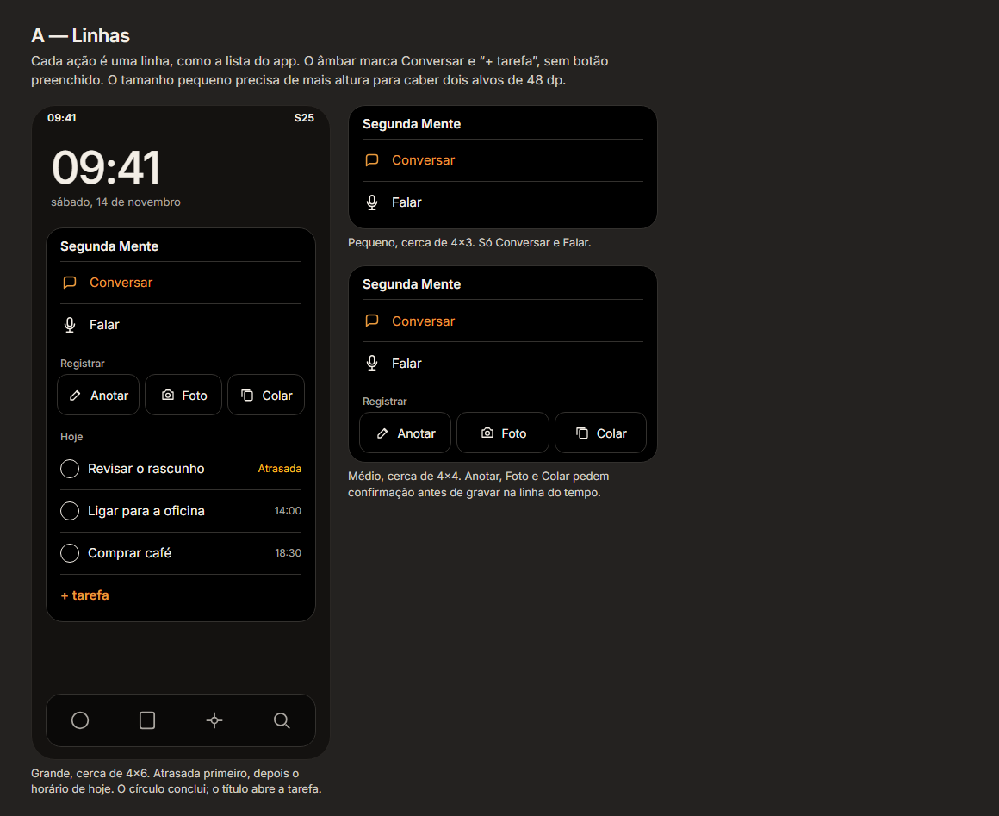
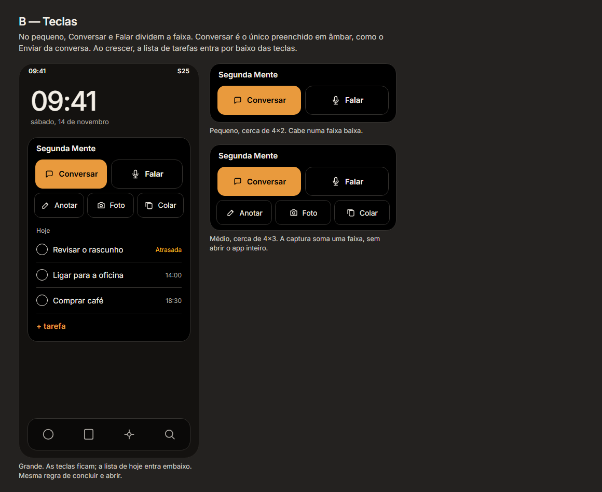
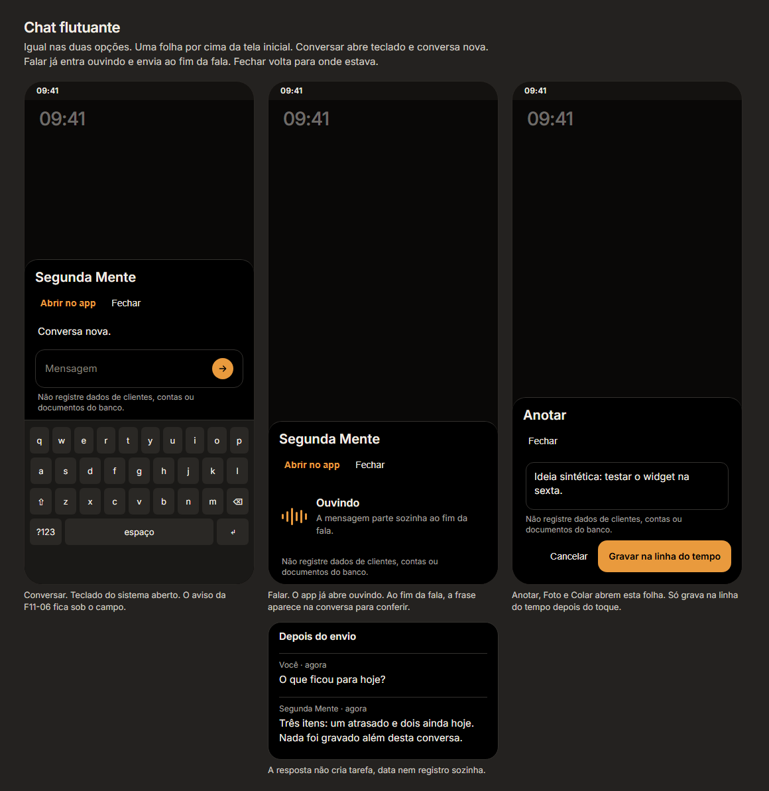
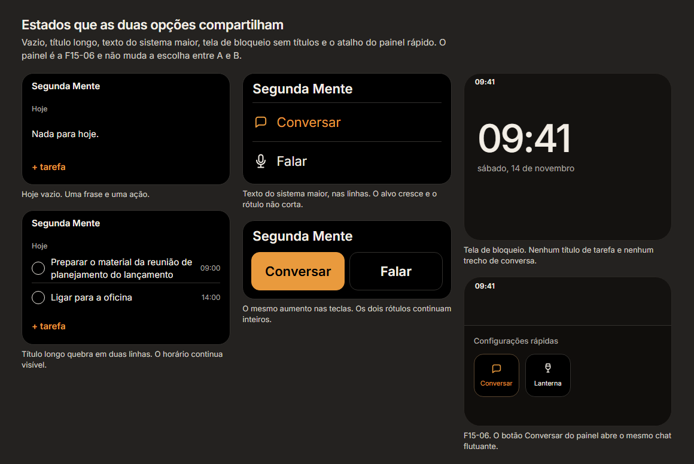

# F15-01 — Maquetes do widget e do chat flutuante

> Subfase da [F15 — Widget e atalhos Android](../roadmap/F15-widget-e-atalhos-android.md). Estado: **DONE** (D-064), com a escolha do dono em 2026-11-14. Estado atual do projeto: [STATE.md](../../STATE.md).

**Fonte:** [maquetes.html](f15-01/maquetes.html), HTML estático na direção AMOLED de [DESIGN.md](../../DESIGN.md). Tarefas, horários e anotações são sintéticos. Nenhum código de produto foi alterado.

**Por que existe:** D-062 manda começar a F15 pelas maquetes, para o dono escolher o visual antes de qualquer widget. D-063 abriu só esta subfase antes do portão da F11, por pedido do dono em 2026-11-14.

## 1. Duas opções

As duas usam o mesmo conteúdo e as mesmas ações. Mudam só a forma de mostrá-las.

### Opção A — Linhas

Cada ação é uma linha, como a lista do app. Conversar e "+ tarefa" ficam em âmbar, sem botão preenchido. O tamanho pequeno ganha altura extra para caber dois alvos de 48 dp.

- Pequeno, cerca de 4×3: Conversar e Falar.
- Médio, cerca de 4×4: + Anotar, Foto e Colar.
- Grande, cerca de 4×6: + até três tarefas de hoje.

### Opção B — Teclas

Conversar preenchido em âmbar e Falar em contorno dividem uma faixa. As demais ações ficam nas faixas abaixo.

- Pequeno, cerca de 4×2: uma faixa baixa com Conversar e Falar.
- Médio, cerca de 4×3: a faixa mais a captura (Anotar, Foto e Colar).
- Grande: as teclas ficam no topo e a lista de hoje entra embaixo. O tamanho exato não foi fixado na maquete.

## 2. O que é igual nas duas

- **Grande:** até três tarefas, atrasada primeiro e depois as de hoje por horário. O círculo conclui a tarefa; o título abre a tarefa; "+ tarefa" cria uma nova.
- **Médio:** Anotar, Foto e Colar abrem uma folha com a confirmação "Gravar na linha do tempo". Nada grava antes do toque.
- **Chat flutuante:** folha sobre a tela inicial, com conversa nova, "Abrir no app" e "Fechar". O aviso da F11-06 fica sob o campo, com o texto literal: "Não registre dados de clientes, contas ou documentos do banco."
- **Conversar** abre o teclado. **Falar** mostra "Ouvindo" e envia a fala ao fim dela.
- **Depois do envio:** a frase fica visível. A resposta não cria tarefa, data nem registro.

Os estados compartilhados são: Hoje vazio; título longo, que quebra em duas linhas com o horário visível; texto do sistema maior, sem corte; tela de bloqueio sem títulos nem trechos de conversa; e o tile "Conversar" do painel de configurações rápidas. Esse tile é a F15-06 e não muda a escolha.

## 3. Estimativa de células

**Estimativa, não medida.** A conta usa a fórmula 70n − 30 dp para n células. O corte real da grade One UI no S25 ainda não foi medido, então o número de células pode mudar em uma unidade.

A fórmula 70n − 30 dp é a do Android para o tamanho mínimo declarado do widget, não o tamanho real da célula. No S25 a célula da One UI tende a ser maior, e por isso a contagem só se confirma medindo no aparelho.

| Tamanho | Opção A, Linhas | Opção B, Teclas |
|---|---|---|
| Pequeno | 4×3 (≈250 × 180 dp) | 4×2 (≈250 × 110 dp) |
| Médio | 4×4 (≈250 × 250 dp) | 4×3 (≈250 × 180 dp) |
| Grande | 4×6 (≈250 × 390 dp) | Não dimensionado: a altura depende da lista de hoje |

A largura de 4 células segue a grade das maquetes.

## 4. Riscos

- **Grade real não medida.** O corte da One UI no S25 pode diferir da fórmula. Medir antes de fixar qualquer tamanho.
- **Abertura a frio do chat não medida.** Pertence à F15-02.
- **Widget de linhas no pequeno** pode passar de duas células de altura. A maquete já aumenta a altura para dois alvos de 48 dp; isso precisa ser conferido no aparelho.
- **Preto puro some em papel de parede escuro.** Por isso a borda usa um fio `#33312E`.
- **Títulos de tarefa** só aparecem na tela inicial, nunca na tela de bloqueio. Trecho de conversa não aparece no widget em nenhum tamanho.
- **Fonte.** DESIGN.md (D-017) fixa a Inter. O arquivo `.impeccable/config.json` ignora a regra `overused-font` só para essa fonte. Isso não é decisão de produto.
- **Texto grande do sistema** foi mostrado só na maquete. Não foi testado no aparelho.
- **Alvos menores que o desenho.** O círculo de concluir (22 dp) e o botão de enviar (32 dp) têm área de toque de 48 dp em volta do desenho. A implementação precisa manter essa área; não foi conferida com TalkBack.

## 5. Escolha pedida ao dono

Qual composição a F15 deve seguir?

1. **A (Linhas)** em todos os tamanhos.
2. **B (Teclas)** em todos os tamanhos.
3. **Combinação:** teclas no pequeno e linhas no grande.

A resposta é a evidência de aceite da F15-01. Ela vira uma decisão nova em [DECISIONS.md](../DECISIONS.md), e só então a F15-01 pode virar DONE. Nenhum código de widget começa antes dessa escolha.

**Escolha (2026-11-14):** combinação (teclas no pequeno, linhas no grande). O dono respondeu "Combinação" no chat. Para o médio, o dono não disse nada: a leitura adotada é que ele segue o pequeno (teclas mais a faixa de captura), e a troca para linhas acontece no grande, onde entra a lista de tarefas de hoje. O dono pode trocar essa leitura sem nova fase. Registro em [D-064](../DECISIONS.md).

## 6. Evidência e NOT_RUN

- **Aparelho:** nenhum. A subfase é de desktop.
- **Render das imagens:** comando `chrome --headless=new --force-device-scale-factor=1 --window-size=1160,2200 --screenshot` sobre cópias por seção do `maquetes.html`, com recorte em Pillow. Saída: os quatro PNG em `docs/imagens/`.
- **Aceite:** escolha do dono no chat em 2026-11-14 (D-064).
- **NOT_RUN:**
  - medição da grade One UI no S25;
  - TalkBack;
  - texto a 200% no aparelho;
  - `flutter test`;
  - `flutter analyze`;
  - qualquer instalação ou toque de widget.
