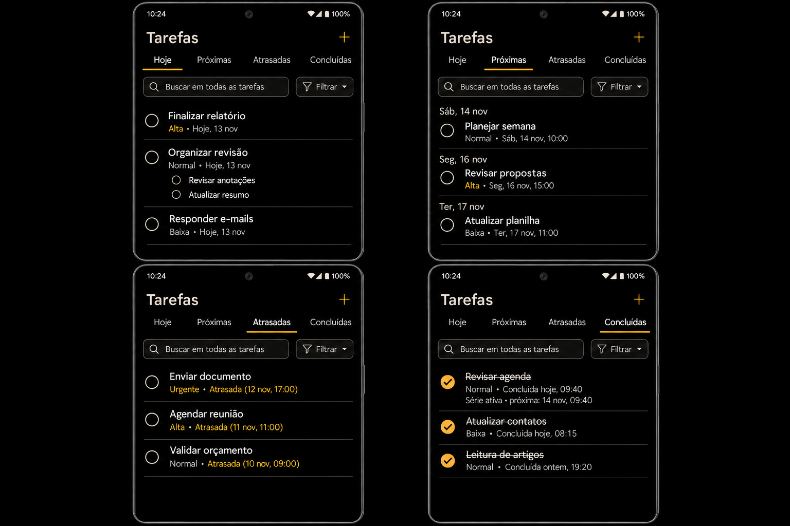
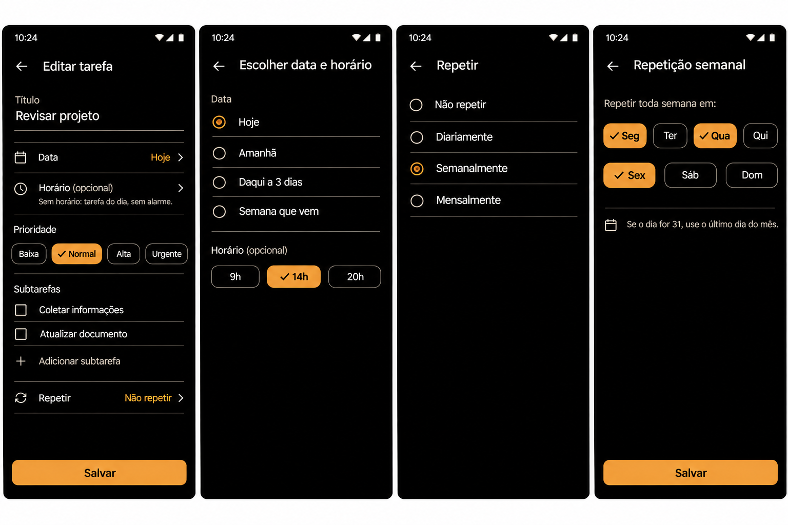
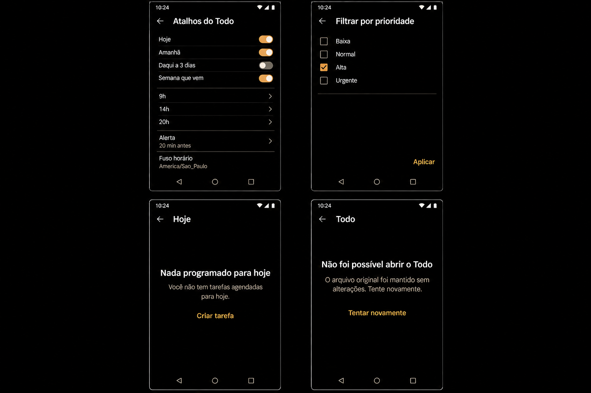
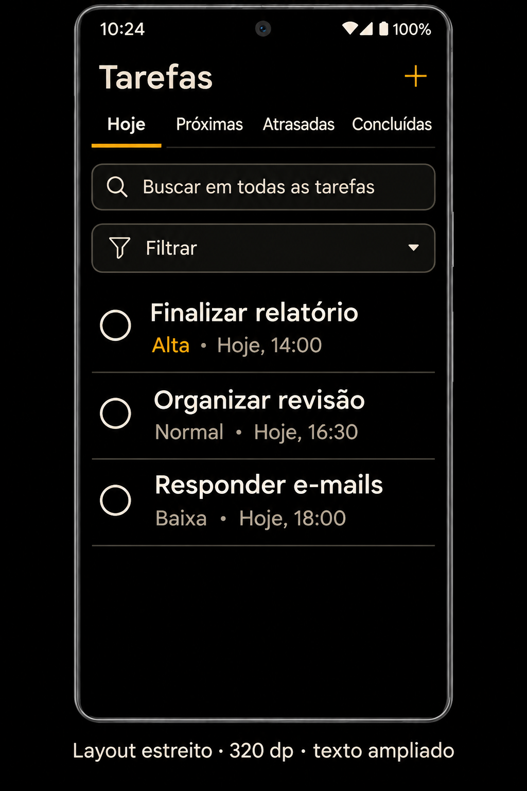
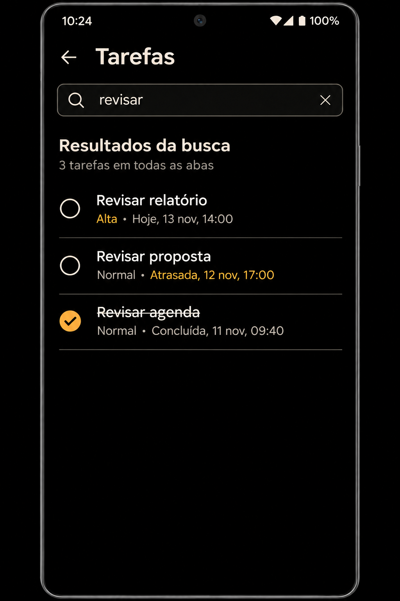
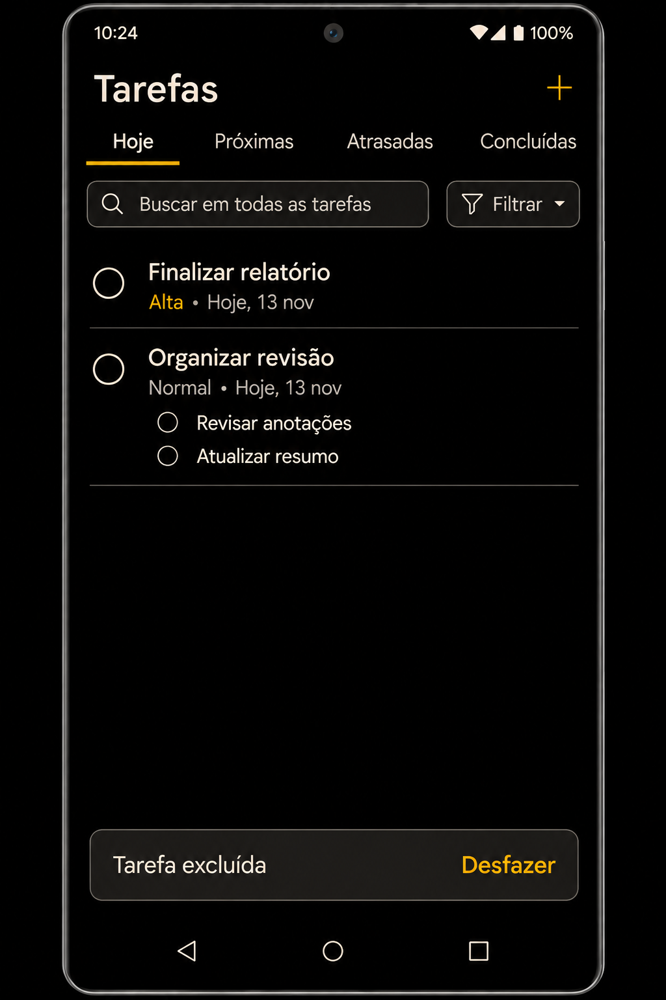

# Referências visuais F11 — conjunto revisado

Pranchas conceituais aprovadas visualmente em 2026-11-13, antes de implementar as telas Flutter. Texto e dados são sintéticos. Direção AMOLED conforme `DESIGN.md`.

## Lista e recorrência

## Configurações e estados

## Adaptações e busca

## Versões anteriores

- [Prancha original de listas](01-listas.png)
- [Prancha original de edição e repetição](02-edicao-e-repeticao.png)
- [Prancha original de configurações e estados](03-configuracoes-e-estados.png)

As revisões visuais aplicam os achados da [crítica Impeccable inicial](critica-impeccable.md). A aprovação cobre as referências visuais; nenhuma tela Flutter foi implementada ainda.

## Exclusão reversível

